# task1

## 验证内容

### 第一轮：汇率变量实验（offline 机制验证）

**验证什么**：汇率改变后，模型第二步用工具真实返回还是旧数字？

**改了什么**：`rates["USD"]`，`7.2 -> 7.0`（本轮唯一改动变量，脚本其余部分不动）。

**预测结果**
- convert_currency 返回多少人民币？700.0
- 脚本里第二次调用写死的是 720.0 * 1.08，calculate 会返回多少？返回 777.6
- check_calculator 会通过吗？预期通过

**实际结果**
- 实验方式：offline 机制验证——模型用 `FakeMessagesListChatModel` 预设工具调用
  序列，不经过真实 LLM，结果完全确定性、可复现

基线（USD=7.2，改前）：全部检查通过：

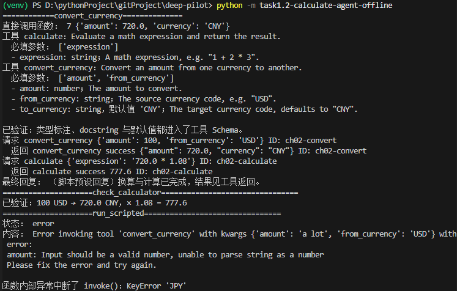

改变量后（USD=7.0）：check_calculator 报错停止：

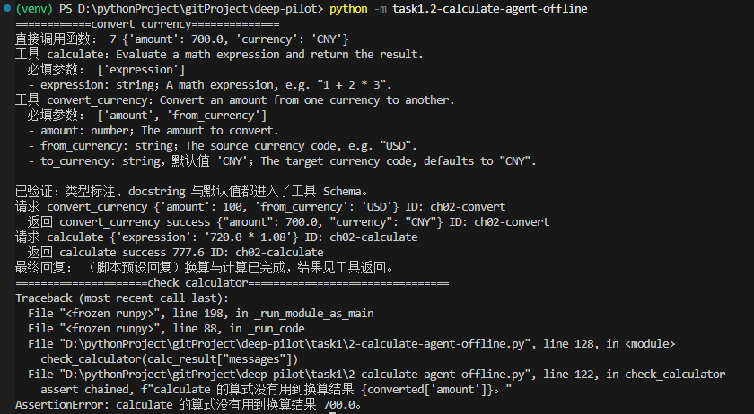

终端关键输出：

```
请求 convert_currency {'amount': 100, 'from_currency': 'USD'}
  返回 convert_currency success {"amount": 700.0, "currency": "CNY"}
请求 calculate {'expression': '720.0 * 1.08'}
  返回 calculate success 777.6
AssertionError: calculate 的算式没有用到换算结果 700.0。
```

- 是否达到预期：**部分达到**。前两条预测全部命中（700.0 / 777.6）；第三条 `check_calculator` 会失败，停留在"AssertionError: calculate 的算式没有用到换算结果 700.0"。

**证据与解释**

- 关键代码：

```python
# 本轮唯一改动：汇率 7.2 → 7.0
rates = {"USD": 7.0, "CNY": 1.0, "EUR": 7.8}

# 第二次工具调用（脚本预设，算式硬编码 720.0，没有使用第一次的工具返回）
AIMessage(content="", tool_calls=[{
    "name": "calculate", "args": {"expression": "720.0 * 1.08"}, "id": "ch02-calculate",
}])
```

- Trace 中实际看到的调用顺序：
  1. `convert_currency(100, "USD")` → `{"amount": 700.0, "currency": "CNY"}`（success）
  2. `calculate("720.0 * 1.08")` → `777.6`（success）——**输入参数仍是 720.0，
     没有变成第一次返回的 700.0**

  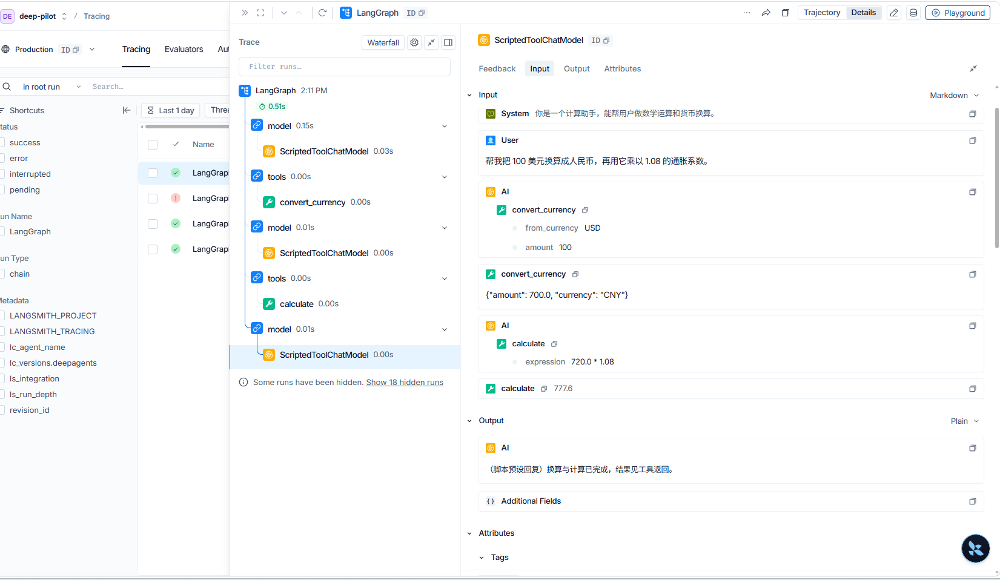

- 证明的结论：offline 实验中第二次调用的是人为写死的数据，证明"脚本写法会割裂两次工具调用之间的数据流"，导致第二步计算用的是旧数字（720.0），而非工具真实返回的 700.0。

### 第二轮：live 真实模型对照实验

**验证什么**：换成真实模型后，模型会不会把第一次工具的返回值传给第二次计算？

**改了什么**：唯一改动变量 = 模型：`FakeMessagesListChatModel`（调用写死）→ `ChatOpenAI`（deepseek-flash）；工具、提问方式不变，汇率也与第 1 轮统一为 7.0。

**预测结果**：模型会读取对话历史里的换算结果，把它写进 calculate 的算式。

**实际结果**
- **模型名称（live 必填）：deepseek-flash**
- 换算返回 700.0，calculate 收到的算式是 `700 * 1.08`，返回 756.0，最终回复正确串联了两步结果：

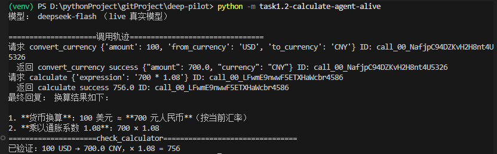

**证据与解释**

- 关键代码：

```python
agent = create_deep_agent(
    model=model,
    tools=[calculate, convert_currency],
    system_prompt="你是一个计算助手，能帮用户做数学运算和货币换算。",
)
```

- Trace 中实际看到的调用顺序：
  1. `convert_currency(100,"USD")` -> `{"amount": 700.0, ...}`(success)
  2. `calculate("700 * 1.08" )` -> `756.0`(success)

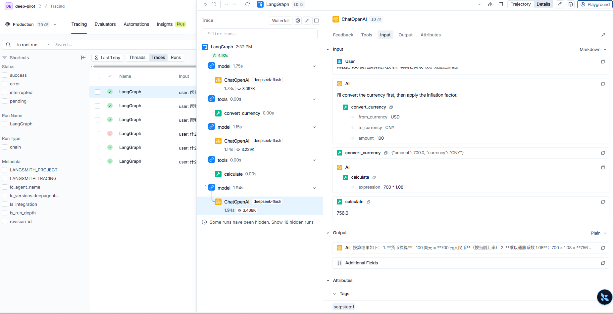

- 证明的结论：live 实验换用真实模型（deepseek-flash）后，模型会从对话历史中读取第一次工具返回的换算结果（700.0），并把它写进第二次工具调用的参数（`700 * 1.08`），最终回答正确（756.0），证明真实模型具备结合历史上下文串联工具结果的能力。


### 第三轮：工具错误透传实验（offline）

**验证什么**：工具调用失败时，框架如何处理？参数错误和工具内部异常是同一种待遇吗？

实验方式：沿用第 1 轮的 `run_scripted` 夹具（agent、工具、提示词全不变），
只改注入的 tool_call，拆成两个子实验（offline 机制验证，无真实模型）。

#### 实验 A：参数类型错误

**改了什么**：注入的 tool_call 里 `amount` 传字符串 `"a lot"`（工具要求数字）。

**预测结果**：得到 error 反馈，`invoke()` 正常结束。

**实际结果**
实验得到的结果:

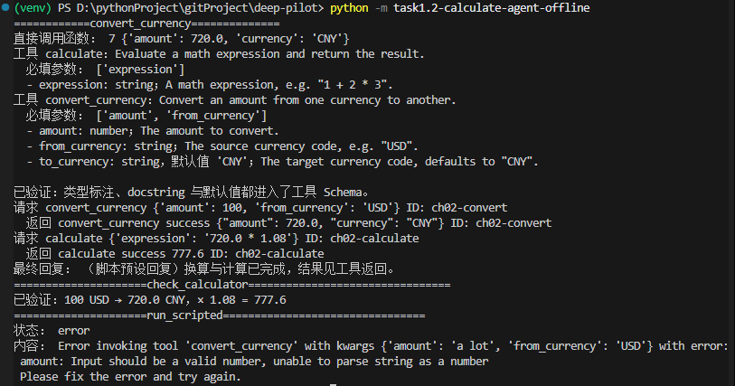

**证据与解释**

- 关键代码：

```python
bad_type = run_scripted({"name": "convert_currency", "id": "ch02-bad-type",
                         "args": {"amount": "a lot", "from_currency": "USD"}})
error_message = next(m for m in bad_type["messages"] if isinstance(m, ToolMessage))
print("状态：", error_message.status)
print("内容：", error_message.content)
assert error_message.status == "error" and "amount" in error_message.content
```

- Trace 中实际看到的调用顺序：
  1. `convert_currency(amount="a lot", from_currency="USD")` -> 工具调用失败
  2. 框架把错误转成反馈回填对话：Error invoking tool 'convert_currency' with kwargs {'amount': 'a lot', 'from_currency': 'USD'} with error: amount: Input should be a valid number, unable to parse string as a number. Please fix the error and try again.

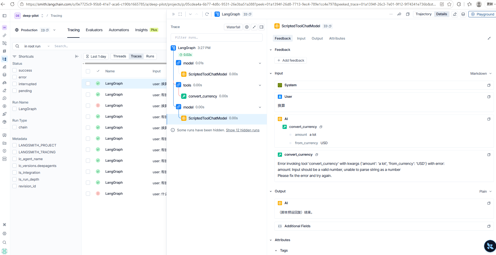

- 证明的结论：参数错误被框架转成"给模型看的反馈"——模型读到后可以自我修正，循环继续，程序不中断。


#### 实验 B：工具内部异常

**改了什么**：注入的 tool_call 里 `from_currency` 传 `"JPY"`（rates 表没有该键，函数内部抛 KeyError）。

**预测结果**：预计 `invoke()` 会被中断，程序无法继续运行。

**实际结果**

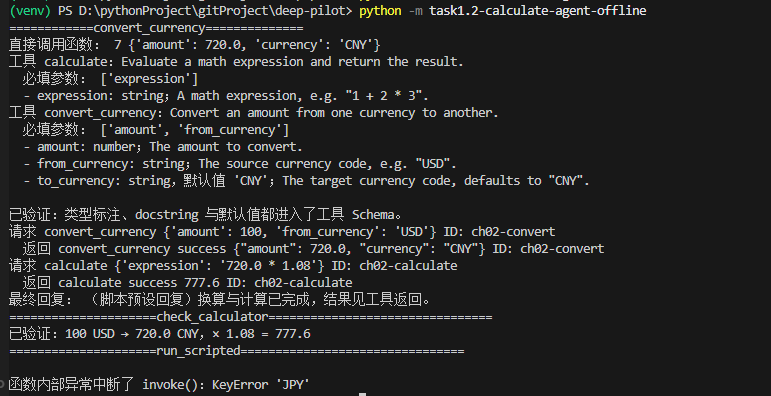

**证据与解释**

- 关键代码：

```python
try:
    # 实验B
    run_scripted({"name": "convert_currency", "id": "ch02-unknown-currency",
                  "args": {"amount": 1, "from_currency": "JPY"}})
except KeyError as error:
    print("\n函数内部异常中断了 invoke()：KeyError", error)
else:
    raise AssertionError("预期 rates['JPY'] 抛出 KeyError。")
```

- Trace 中实际看到的调用顺序：

  1. `convert_currency(amount=1, from_currency="JPY")` -> 工具调用异常中断

  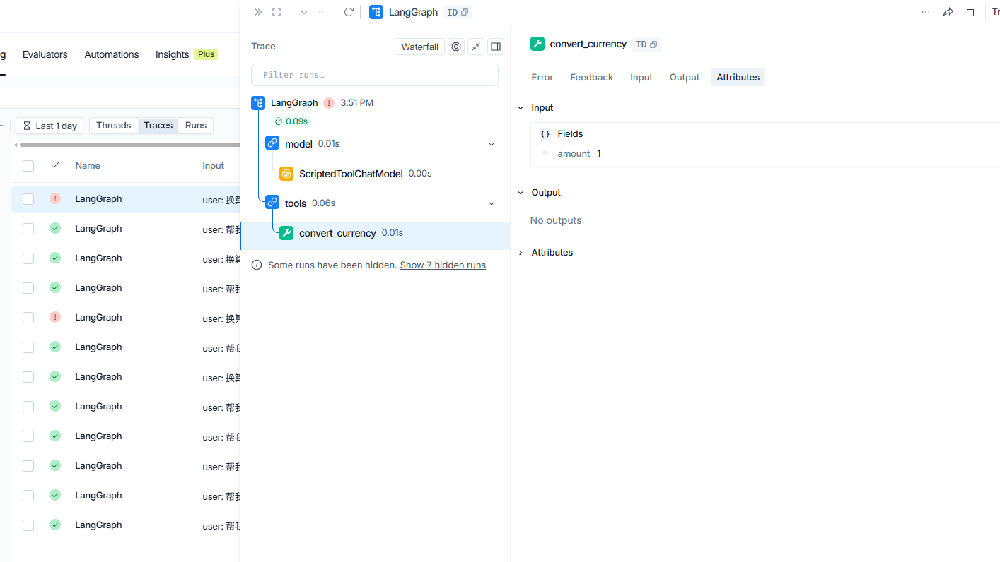

- 证明结论：工具内部异常不会被转成"给模型看的反馈"，而是直接中断后暴露给程序员。

**两个实验合起来的结论**：框架按"**错误能否通过重试解决**"分流——参数错误可恢复（回给模型自我修正）；内部异常不可恢复（换什么参数都躲不开代码 bug），
直接抛出让程序员修复。

### 第四轮：规划中间件拆除实验（live）

**验证什么**：`write_todos`（规划工具）到底是谁提供的——Deep Agent 自带，还是 `TodoListMiddleware` 注册的？拆掉它之后，Agent 还能完成研究任务吗？

**改了什么**：唯一改动变量 = 注释 `middleware=[TodoListMiddleware()]`（task1/2-research-agent.py），模型、Tavily 搜索工具、系统提示词、提问全部不变。

**预测结果**
- 注册清单中 `write_todos` 消失，断言失败
- 脚本仍会请求 `write_todos`，返回 `status: error`"write_todos is not a valid tool"
- result 中 todos 状态消失，研究任务仍能完成

**实际结果**
- **模型名称（live 必填）：deepseek-flash**（Tavily 联网搜索真实执行）
- 工具注册结果：

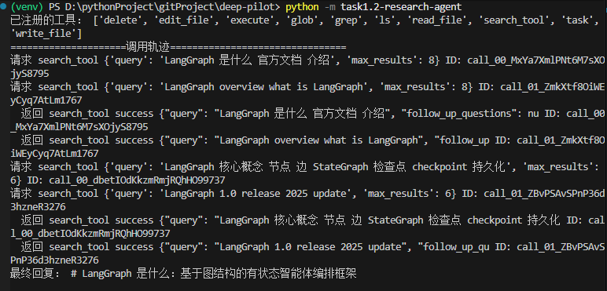

- Trace 中实际看的结果：

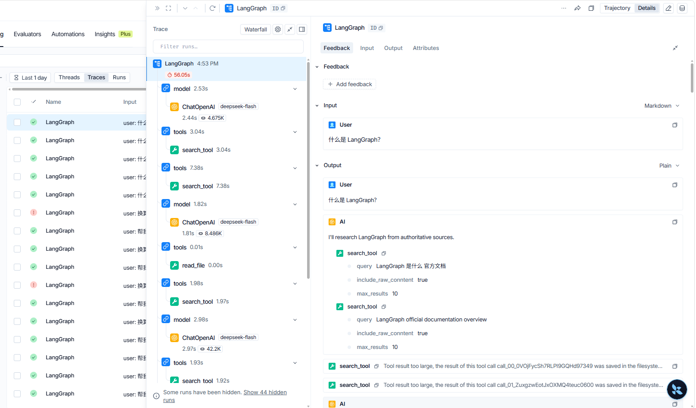


**证据与解释**

- 关键代码：

```python
# 工具整合到Agent
agent = create_deep_agent(
    model = model,
    tools = [search_tool],
    system_prompt=system_prompt,
    # middleware = [TodoListMiddleware()]
)
```

- 注册清单对比：关闭后同一清单但无 `write_todos`——**规划工具确实来自中间件注册，不是 Deep Agent 默认自带**（预测命中）。
- 偏差 1：模型没有幻觉调用 `write_todos`（课程预期出现 2 次 "not a valid tool"）。
- 偏差 2（更关键）：`todos` 状态键无论开关 middleware 都不出现在 result 中（始终只有 `files`/`messages`），与课程预期不同。
- 证明的结论：`write_todos` 规划工具由 `TodoListMiddleware` 注册提供，不是 Deep Agent 默认自带——拆除 middleware 后它从注册清单消失，断言随即失败。


## 遇到的问题

### LangSmith 追踪失败
LangSmith的页面中，无法找到对应的Trace记录

[图片]

**解决方案**：环境变量中需要设定下列参数：

```bash
# 开启LangSmith链路追踪
LANGSMITH_TRACING=true
# 输入你LangSmith的api_key
LANGSMITH_API_KEY=你的api_key
# 输入LangSmith的链路项目
LANGSMITH_PROJECT=你的项目名
```

最后重新运行的结果：

[图片]

LangSmith 链路结果：

[图片]


## 总结

本轮围绕"工具间数据如何流动"做了四轮实验。第 1 轮用 offline 假模型做单变量
实验：只改汇率 7.2→7.0，第一步工具返回变为 700.0，第二次计算仍用写死的
720.0，check_calculator 精确报错，实证"数据流被硬编码切断"。第 2 轮在统一
汇率（7.0）后换 deepseek-flash 做 live 对照：模型把换算结果 700 动态写进第二
次调用的算式（700×1.08=756.0），证明真实模型会从对话历史取值串联工具——并
澄清了机制：不是模型"保存"了状态，而是框架把工具返回回填进 messages 历史。
同样的汇率变化，写死算式的 offline 卡在旧数字 777.6，真模型自适应算出 756.0，
形成直接对照。第 3 轮验证框架按"错误能否通过重试解决"分流：参数错误转
error 消息回给模型，工具内部异常直接中断 invoke 抛给程序员。第 4 轮拆除
规划中间件：断言失败证实 write_todos 来自 TodoListMiddleware 注册而非
Deep Agent 内置；真实模型未幻觉调用该工具也完成了研究任务；并发现 deepagents
显式钉死 state_schema（graph.py:1001），todos 状态键不随 middleware 出现，
与课程材料预期不同。四轮预测中的偏差（check 通过与否、内部异常的处理方式、
幻觉调用未复现、todos 状态缺失）均已如实记录并修正认知。